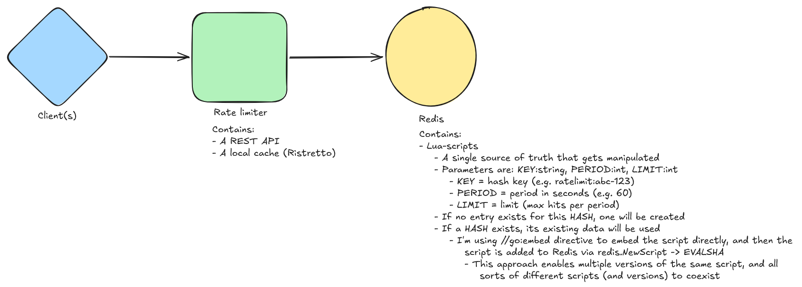
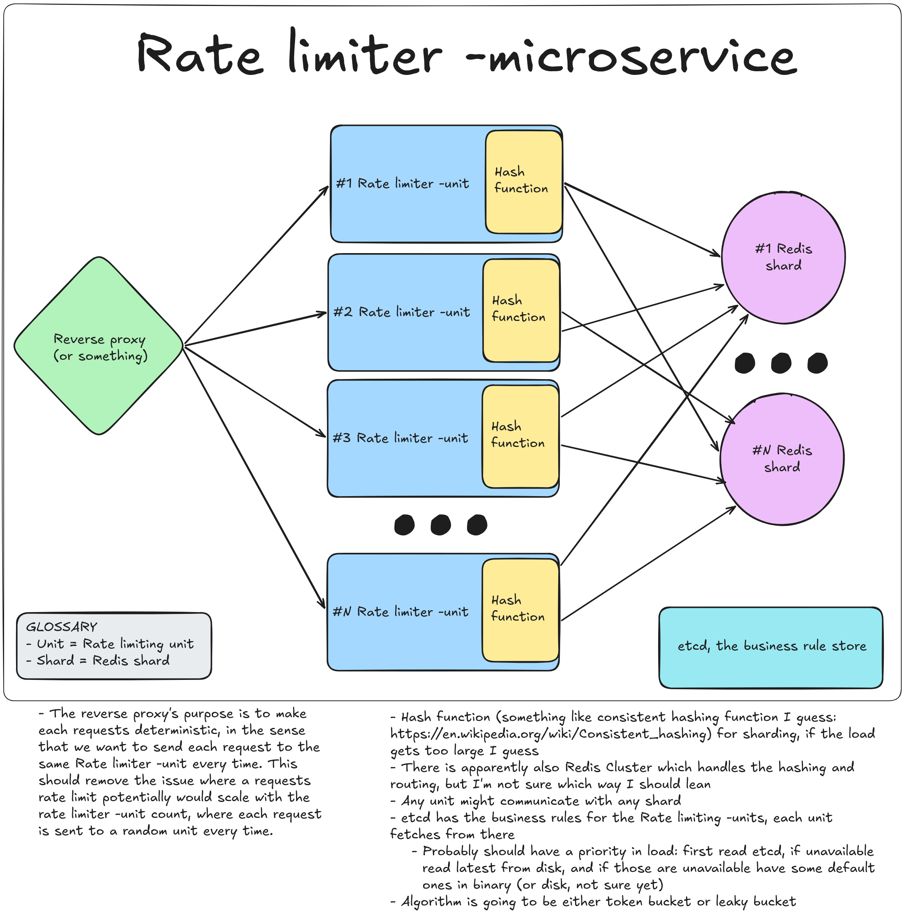

# Luna limiter
> A Go-based rate limiter -microservice, with the goal of turning it into a distributed rate limiter

> **Status:** a learning project, not production-ready.

Tech used: Go, Redis, Docker, K6

# What is a rate limiter?
Rate limiting is a common backend concern used to protect services, enforce fair usage, and improve overall system reliability.

# Motivation
This project was built to better understand:
- How rate limiting can be implemented as a standalone backend service
- Trade-offs involved in using shared state (Redis) for coordination
- Concurrency behavior and performance under load
- How system design decisions impact latency and throughput

The implementation was inspired by backend engineering talks and real-world use cases discussed in industry presentations.

# High-level design
- Language: Go
- Architecture: Standalone microservice
- State management: Redis (shared backend)
- API: HTTP-based interface for rate-limited requests
- Focus areas: correctness, testability, and performance experimentation

Redis is used to coordinate rate-limit state across requests (since every request is processed sequentially by Redis), keeping the service stateless from the application perspective.



## Future implementation


# Current Scope
## Implemented
- Core rate-limiting logic
- Redis integration
	- Redis is used to enable:
		- Share state across rate limiter instances
		- A single source of truth for time and counters
		- Atomic updates via Lua scripts
		- Reduced network round-trips for critical paths
			- Otherwise you'd have to fetch and update, and that isn't atomic either in addition to the extra round-trip
	    - Versioned rate-limiting algorithms, with identifiers stored in Redis to allow multiple strategies and versions to coexist
- Basic service setup and configuration
- Load testing using k6
- Local development setup

## Out of Scope / Not Implemented
- Multi-node deployment (WIP)
- Advanced fault tolerance
- Dynamic configuration management (WIP)
- Observability
- Security hardening

These are intentionally left out to keep the project focused and manageable

# Running the Project
## Prerequisites
- Go, at least version 1.24.5
- Redis
- Docker (optional)
	- IMPORTANT: As of 06-10-2026, at least my instance of `Windows 11 Pro (Version 10.0.26200 Build 26200)` requires `%USERPROFILE%\.testcontainers.properties` to be as `ryuk.disabled=true`, because Ryuk (the testcontainers reaper-sidecar) for some weird reason stopped working when Windows 11 updated. I attempted to fix the issue a bit more neatly, but nothing else seems to do the job
- k6 (optional: for load testing)

## Nice to have
- Task, https://taskfile.dev/
- HTTPYac extension in vscode

# Local Run (example)
- Start Redis locally with `docker compose up -d`
- Run application with `task run` (if Task is installed)
- Alternatively, you can compile, and run from CLI
```
// Compile
go build -o bin/distributed-rate-limiter.exe

// Run
bin/distributed-rate-limiter.exe --redisaddr "127.0.0.1:6379" --redisuser "default" --redispassword "redis123" --period 60 --reqlimit 2 --port 12600 --log_format "dev"

/* Parameters 
	--redisaddr::string
		- the address of the Redis instance
	--redisuser::string
		- Redis username
	--redispassword::string
		- Redis password
	--period::int
		- The period after the users request limit resets
	--reqlimit::int
		- Request limit per user (user groups to come at some point)
	--port::int
		- the port the service will be at
	--log_format::string["dev" | "prod"]
		- Log formatting, either JSON for the eventual production deployment, or the pretty to read dev format
	
*/

```
- Send HTTP requests to the rate-limiter endpoint
	- There is a .http file in root, I'm using the [HTTPYac-extension](https://marketplace.visualstudio.com/items?itemName=anweber.vscode-httpyac)

# Design Decisions & Trade-offs
- Redis was chosen for simplicity and atomic operations, at the cost of added latency and a shared dependency
- Lua scripts reduce round-trips but increase coupling to Redis
- The service is stateless by design, simplifying horizontal scaling but shifting consistency concerns to Redis

# Disclaimer
This project is intended for learning and experimentation and does not aim to meet production requirements.
