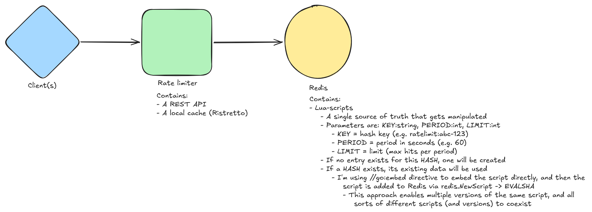

<!---
    your comment goes here and here
-->

# What is a rate-limiter?
Per wikipedia: https://en.wikipedia.org/wiki/Rate_limiting

    In computer networks, rate limiting is used to control the rate of requests sent or received by a network interface controller. It can be used to prevent DoS attacks and limit web scraping.

In this projects case, I'd like to limit different groups with different rule-sets, as efficiently as possible

# Types of rate limiters

| Type            |                                                             |
|-----------------|-------------------------------------------------------------|
| In-application  | Resides within the target application                       |
| Integrated      | Integrated into a third-party service, such as load-balance |
| Service-level   | As its own service in the service mesh                      |
| Sidecar         | A sidecar container                                         |

# Use cases for the different types
Each type has its own use-cases, and they can used in unison (and I've understood that commonly that is the case)

## In-application
With this type of rate limiting, there is no need to make round-trips to other services, so it is approximately instant

Useful when the client can only connect to the services in only one way, such as a mobile application

## Integrated
In other services such as load-balancers, reverse-proxies and so on

Good for coarse rate limiting, such as:
- Bots
- DDoS attacks
- Scrapers

## Service-level
Good for business rules, and more complicated behaviour

Can also include other components, such as an elaborate bot-detection system which combines multiple data-sources

In my case

## Sidecar

# Algorithms
- Fixed-window - 
- Token bucket - 
- Leaky bucket - 
- Sliding window - 

## Internals (my case)
I'm using the internal Lua-scripts to manipulate the data in Redis, so there is a single source of truth at all times

Parameters are for the script: 
- `KEY`**:**`string` 
    - hash key (e.g. ratelimit:abc-123)
- `PERIOD`**:**`int`
    - period in seconds (e.g. 60)
- `LIMIT`**:**`int`
    - limit (max hits per period)

I'm using `//go:embed` directive to embed the script directly, and then the script is added to Redis via `redis.NewScript` -> `EVALSHA`

This approach enables multiple versions of the same script, and all  sorts of different scripts (and versions) to coexist

# Key-schema

# Usages
?

# Architectural and behavioural problems I've come accross
I've not yet implemented these though

## Making sure every request routes to the same Redis shard

## Making sure each request routes to the same rate limiter

